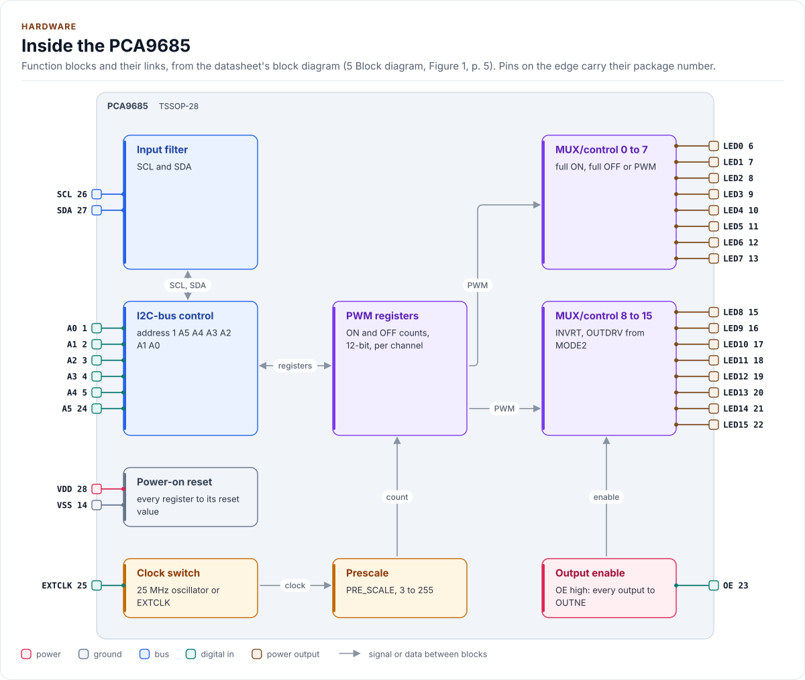
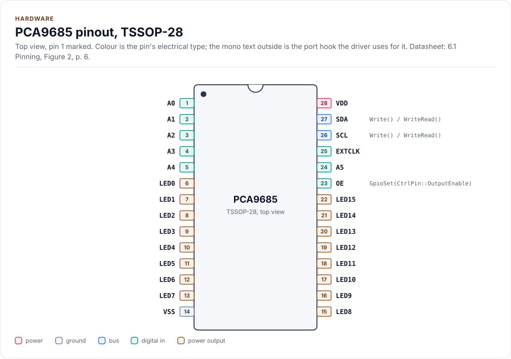
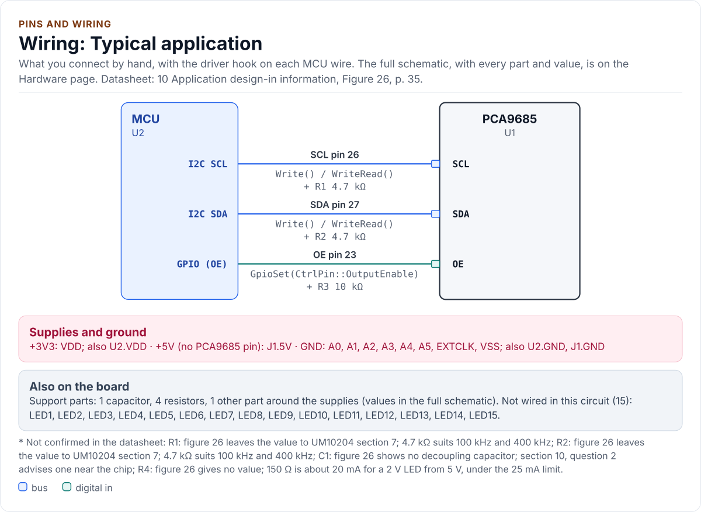

# PCA9685 Driver

<!-- generated: chip-summary -->
The **PCA9685** is a 16-channel LED controller on I2C: each output has its own 12-bit PWM, all at one frequency from
about 24 Hz to 1526 Hz, and drives an LED directly or the input of an external driver (1 General description, [p.
1](https://www.nxp.com/docs/en/data-sheet/PCA9685.pdf#page=1)).
<!-- /generated -->

C++20 driver for the NXP PCA9685 16-channel, 12-bit PWM controller on I2C.

[](https://github.com/kokeb-labs-drivers/driver-pca9685/actions/workflows/ci.yml)
[](LICENSE)
[](docs/installation.md#requirements)

**Documentation: [`docs/`](docs/index.md)**, with the API reference built by Doxygen ([how](docs/api-reference.md)).
The site at <https://kokeb-labs-drivers.github.io/driver-pca9685/> opens when the repository is public.

<!-- figure: chip-hero -->
<picture>
  <source media="(prefers-color-scheme: dark)" srcset="docs/diagrams/chip-hero.dark.svg">
  
</picture>
<!-- /figure -->

## What it does

<!-- figure: chip-capabilities -->
<picture>
  <source media="(prefers-color-scheme: dark)" srcset="docs/diagrams/chip-capabilities.dark.svg">
  
</picture>
<!-- /figure -->

## Where it is used

<!-- generated: chip-uses -->
- RGB or RGBA LED drivers (3, [p. 3](https://www.nxp.com/docs/en/data-sheet/PCA9685.pdf#page=3))
- LED status information (3, [p. 3](https://www.nxp.com/docs/en/data-sheet/PCA9685.pdf#page=3))
- LED displays (3, [p. 3](https://www.nxp.com/docs/en/data-sheet/PCA9685.pdf#page=3))
- LCD backlights (3, [p. 3](https://www.nxp.com/docs/en/data-sheet/PCA9685.pdf#page=3))
- Keypad backlights of handheld devices (3, [p. 3](https://www.nxp.com/docs/en/data-sheet/PCA9685.pdf#page=3))

Uses named by the datasheet (1 General description, [p. 1](https://www.nxp.com/docs/en/data-sheet/PCA9685.pdf#page=1)).
<!-- /generated -->

## Inside the chip

<!-- figure: chip-blocks -->
<picture>
  <source media="(prefers-color-scheme: dark)" srcset="docs/diagrams/chip-blocks.dark.svg">
  
</picture>
<!-- /figure -->

## Pins and wiring

<!-- figure: chip-pinout -->
<picture>
  <source media="(prefers-color-scheme: dark)" srcset="docs/diagrams/chip-pinout.dark.svg">
  
</picture>
<!-- /figure -->

<!-- figure: chip-wiring-typical -->
<picture>
  <source media="(prefers-color-scheme: dark)" srcset="docs/diagrams/chip-wiring-typical.dark.svg">
  
</picture>
<!-- /figure -->

| MCU | PCA9685 (TSSOP28 pin) | Notes |
| --- | --- | --- |
| I2C SCL | SCL (26) | Pull-up to VDD; 4.7 kΩ suits 100 kHz and 400 kHz |
| I2C SDA | SDA (27) | Pull-up to VDD |
| GND | A0 to A5 (1 to 5, 24) | Address `0x40` (`kI2cAddress`); never leave one open |
| GND | EXTCLK (25) | Grounded unless an external clock drives it |
| GPIO, or GND | OE (23) | Optional; with a pull-up the outputs stay off until the MCU drives it low |
| 2.3 V to 5.5 V | VDD (28) | 100 nF to VSS close to the pin |
| GND | VSS (14) | |

<!-- generated: chip-card -->
| | | Datasheet |
| --- | --- | --- |
| **Package** | TSSOP-28 | 6.1, [p. 6](https://www.nxp.com/docs/en/data-sheet/PCA9685.pdf#page=6) |
| **Pins** | 28 | 6.1, [p. 6](https://www.nxp.com/docs/en/data-sheet/PCA9685.pdf#page=6) |
| **Supply VDD** | 2.3 V to 5.5 V | 12, [p. 38](https://www.nxp.com/docs/en/data-sheet/PCA9685.pdf#page=38) |

From [`docs/hardware.yml`](docs/hardware.yml); pins, circuits and the block diagram: [Hardware](docs/hardware.md).
<!-- /generated -->

## Quick start

**1. Wire it** as in [Pins and wiring](#pins-and-wiring).

**2. Write the port**: a class with `EnsureInitialized()` (bring the bus up), `Write()` and `WriteRead()` (one I2C
transaction each) and `DelayUs()`, about 20 lines on most SDKs. [Porting](docs/porting.md) has the contract and a
complete example.

**3. Drive a channel:**

<!-- generated: quickstart-code -->
```cpp
#include "pca9685.hpp"

int dim_led_to_quarter(MyPort& port) {
  pca9685::PCA9685<MyPort> pwm(port); // address 0x40 (A5..A0 low), Config{}: no I/O yet

  if (auto r = pwm.EnsureInitialized(); !r) { // 1. every channel off, configured, oscillator on
    return static_cast<int>(r.error); //    Bus or DeviceIdMismatch: check wiring and address
  }
  if (auto r = pwm.SetDuty(0, 1024); !r) { // 2. LED0 on for 1024 of 4096 counts, 200 Hz
    return static_cast<int>(r.error);
  }
  return static_cast<int>(pwm.SetChannelOff(0).error); // 3. off again: never refused
}
```
<!-- /generated -->

`EnsureInitialized()` is the only call that starts the chip. Every other call returns `Error::NotInitialized`
until it has succeeded, and no channel call ever starts the chip on its own.

## Driver coverage

<!-- generated: chip-coverage -->
| Capability | What the chip does | Driver API | Registers | Status | Datasheet |
| --- | --- | --- | --- | --- | --- |
| [PWM per channel](docs/api-guide.md) | Sets each output's duty and turn-on delay in 4096 steps, or a servo pulse width in microseconds | `SetPwm`, `SetDuty`, `SetPulseWidthUs`, `ReadChannel` | `LED0_ON_L`, `LED15_OFF_H` | Supported | 7.3.3, [p. 16](https://www.nxp.com/docs/en/data-sheet/PCA9685.pdf#page=16) |
| [Full on and full off](docs/api-guide.md) | Holds an output fully on or fully off with no PWM; a switch-off is never refused | `SetFullOn`, `SetChannelOff`, `SetChannelsOff` | `LED0_ON_L`, `LED15_OFF_H` | Supported | 7.3.3, [p. 16](https://www.nxp.com/docs/en/data-sheet/PCA9685.pdf#page=16) |
| [All channels at once](docs/api-guide.md) | Switches every output off with one write, or changes a run of channels together in one transfer | `SetAllOff`, `SetChannels` | `ALL_LED_OFF_H`, `LED0_ON_L`, `LED15_OFF_H` | Supported | 7.3.4, [p. 25](https://www.nxp.com/docs/en/data-sheet/PCA9685.pdf#page=25) |
| [PWM frequency and clock](docs/configuration.md) | One frequency for all outputs, from the 25 MHz oscillator or an external clock up to 50 MHz | `SetPwmFrequency`, `GetPwmFrequencyHz`, `ReadPrescale`, `ClockSource` | `PRE_SCALE`, `MODE1` | Supported | 7.3.5, [p. 25](https://www.nxp.com/docs/en/data-sheet/PCA9685.pdf#page=25) |
| [Output drive and inversion](docs/configuration.md) | Totem pole or open-drain outputs, optionally inverted, for direct LEDs or external drivers | `OutputDrive`, `DirectLedPreset`, `ApplyConfig` | `MODE2` | Supported | 7.3.2, [p. 16](https://www.nxp.com/docs/en/data-sheet/PCA9685.pdf#page=16) |
| [Output enable pin](docs/hardware.md) | Switches every output to its off level at once through the OE pin, with no bus traffic | `DisableOutputs`, `EnableOutputs` | `MODE2` | Supported | 7.4, [p. 27](https://www.nxp.com/docs/en/data-sheet/PCA9685.pdf#page=27) |
| [Sleep and restart](docs/api-guide.md) | Stops the oscillator to save power, then restarts the PWM where it stopped | `Sleep`, `Wake`, `MayBeAsleep` | `MODE1` | Supported | 7.3.1.1, [p. 15](https://www.nxp.com/docs/en/data-sheet/PCA9685.pdf#page=15) |
| [Reset detection](docs/contract.md) | Starts from any state with every output off, and finds a power-on or software reset | `EnsureInitialized`, `CheckForReset` | `MODE1`, `MODE2`, `SUBADR1` | Supported | 7.5, [p. 27](https://www.nxp.com/docs/en/data-sheet/PCA9685.pdf#page=27) |
| [Group addresses](docs/hardware.md) | LED All Call and three Sub Call addresses; the driver disables them so the chip answers its own only | - | `ALLCALLADR`, `SUBADR1`, `SUBADR2`, `SUBADR3` | Not covered | 7.1.2, [p. 8](https://www.nxp.com/docs/en/data-sheet/PCA9685.pdf#page=8) |

**Supported**: the driver covers it and a host test checks it; **Not covered**: the chip has it and the driver leaves it
alone.

From [`docs/hardware.yml`](docs/hardware.yml); `kokeb-docs hardware --check` confirms that every API name is in
`inc/pca9685.hpp`, `inc/pca9685_types.hpp` and every register in `inc/pca9685_registers.hpp`.
<!-- /generated -->

This driver starts the chip from any state with every output off, writes each channel's four registers in one transfer,
programs the frequency by the data sheet's sleep and restart sequence, and finds a power-on or software reset of the
chip. A switch-off is never refused, whatever the driver doubts, and the OE pin switches every output off without the
bus. It runs on any MCU: you give it a small class that moves bytes on your bus, and it does the rest.

| | |
| --- | --- |
| **Bus** | I2C up to 1 MHz (Fm+); 7-bit address `0x40` to `0x7F` from A0 to A5 |
| **Also drives** | The OE pin (all outputs off at once), when your port has `GpioSet()` |
| **Driver** | Header-only C++20; no heap, exceptions, RTTI or virtual calls; every call returns `Result<T>` |
| **Runs on** | Any MCU with I2C and a C++20 compiler; the host example runs on any PC ([Platforms](docs/platforms.md)) |
| **Status** | 0.1.0, not yet verified on hardware: host-tested against a register model of the chip |

- Starts the chip from whatever an earlier run left: every output off first, then the configuration written and
  read back (an identity check no floating or stuck line can pass), then the oscillator woken.
- Sets each channel by counts, duty and phase, or pulse width in microseconds from the programmed prescaler; up to
  16 channels in one transfer, which change together at the STOP.
- Changes the frequency by the data sheet's sleep, PRE_SCALE and restart sequence, and reads PRE_SCALE back.
- Finds a power-on or software reset (MODE1.AI or the SUBADR1 sentinel back at its reset value, confirmed by a
  second read), and never writes its cached state over a reset chip.
- Sends every switch-off as one data byte, so even a failed one never makes a channel more active; never refuses a
  switch-off; treats a failed switch-on as possibly delivered; switches every output off through OE.
- Returns `Result<T>` with an `Error` from every call: no exceptions, no heap, no RTTI, no virtual calls.

## Documentation

| Page | Read it when you want to |
| --- | --- |
| [Quickstart](docs/quickstart.md) | Go from a bare chip to a dimmed LED on your MCU |
| [Hardware](docs/hardware.md) | Wire it: pins, address, OE, EXTCLK, pull-ups, LEDs and servos, power |
| [Porting](docs/porting.md) | Write the port class for your MCU's SDK |
| [API guide](docs/api-guide.md) | Use each call: start, set channels, frequency, sleep, resets, errors |
| [Configuration](docs/configuration.md) | Choose every setting, or start from a preset |
| [Troubleshooting](docs/troubleshooting.md) | Find the cause of an error or an output that does not do what you set |
| [Contract](docs/contract.md) | Know exactly what the driver promises, needs and returns |
| [Datasheet map](docs/datasheet.md) | Find the datasheet section behind each part of the driver |
| [API reference](docs/api-reference.md) | Look up a class or member (Doxygen; built by CI and locally) |

## Datasheet

<!-- generated: datasheet-card -->
| Document | Revision | Get it |
| --- | --- | --- |
| Datasheet: PCA9685 16-channel, 12-bit PWM Fm+ I2C-bus LED controller (NXP PCA9685) | Rev. 4, 2015-04-16 | [PDF](https://www.nxp.com/docs/en/data-sheet/PCA9685.pdf) · [vendor page](https://www.nxp.com/products/PCA9685) |

Written against these revisions; the SHA-256 of each file is in [`docs/datasheets.yml`](docs/datasheets.yml). Where each
part of the driver is in the datasheet: [Datasheet map](docs/datasheet.md).
<!-- /generated -->

Every docs page lists the datasheet sections it relies on, and code comments cite the section they implement.

## Try it on your PC

No hardware needed: [`examples/host`](examples/host/README.md) runs the driver against a simulated chip.
You need git, CMake 3.16+ and a C++20 compiler (GCC 10+, Clang 13+ or MSVC 2022).

1. Get the source:

   ```bash
   git clone https://github.com/kokeb-labs-drivers/driver-pca9685.git && cd driver-pca9685
   ```

2. Build and run the example:

   ```bash
   cmake -S examples/host -B build-example
   cmake --build build-example
   ./build-example/pca9685_host_example
   ```

3. You should see the driver start the simulated chip at 50 Hz, fade LED0 and centre a servo on LED1:

   ```text
   PCA9685 driver 0.1.0 on the host
   pca9685: initialised
   PWM 50 Hz (PRE_SCALE 121)
   LED0 duty 0/4096
   LED0 duty 1024/4096
   LED0 duty 2048/4096
   LED0 duty 3072/4096
   LED0 duty 4096/4096
   servo on LED1: 1498160 ns pulse
   ```

To run the whole test suite instead: `cmake -S . -B build -DPCA9685_BUILD_TESTS=ON && cmake --build build && ctest
--test-dir build`.

## Add it to your project

Pick the row that matches your build; each is a few steps, and [Installation](docs/installation.md) has the
details.

| Your build | Steps below |
| --- | --- |
| Plain CMake: STM32 (CubeMX), RP2040 (Pico SDK), nRF Connect, a host app | [A](#a-cmake-any-mcu) |
| ESP-IDF | [B](#b-esp-idf) |
| An SDK or OS image that installs libraries | [C](#c-installed-package) |

### A. CMake, any MCU

1. Add the driver as a submodule, pinned to the version you chose:

   ```bash
   git submodule add https://github.com/kokeb-labs-drivers/driver-pca9685.git external/driver-pca9685
   ```

2. In your `CMakeLists.txt`, after `project()`:

   ```cmake
   add_subdirectory(external/driver-pca9685)
   target_link_libraries(my_app PRIVATE pca9685::pca9685)   # brings the headers and C++20
   ```

3. In your code, `#include "pca9685.hpp"`, write the port ([Porting](docs/porting.md)) and build. A first build
   that compiles the quickstart above is the check that the driver is wired in.

### B. ESP-IDF

1. Add the driver under your project's `components/`; ESP-IDF finds it there and names it after the folder:

   ```bash
   git submodule add https://github.com/kokeb-labs-drivers/driver-pca9685.git components/pca9685
   ```

2. In `main/CMakeLists.txt`, list it: `idf_component_register(SRCS "main.cpp" REQUIRES pca9685)`.
3. `idf.py menuconfig` now has a **PCA9685 PWM controller** menu (frequency, oscillator, clock source, output
   drive, inversion), and `idf.py build` builds the driver with your app. [`examples/esp32`](examples/esp32) is a
   complete project with a port for the board.

### C. Installed package

1. Install it once into a prefix:

   ```bash
   cmake -S external/driver-pca9685 -B build-pca9685 && cmake --install build-pca9685 --prefix /opt/sdk
   ```

2. In your project, with `CMAKE_PREFIX_PATH=/opt/sdk`:

   ```cmake
   find_package(pca9685 0.1 REQUIRED)
   target_link_libraries(my_app PRIVATE pca9685::pca9685)
   ```

The target is `pca9685::pca9685` every way, so switching later changes nothing else.

## Tests and quality

```bash
cmake -S . -B build -DPCA9685_BUILD_TESTS=ON && cmake --build build && ctest --test-dir build
```

The host tests run the driver against a register model of the chip that resets, sleeps and restarts on its own and
offers both readings of every question the data sheet leaves open; they fail, NACK part-way and drop every bus
transfer in turn and produce each error the driver can return. A fuzzer does the same at random and checks the
safety rules after every call: a switch-off is always sent, and an `Ok` switch-off is off on the chip. CI also
builds for Cortex-M and gates coverage, complexity, sanitizers, fuzzing, clang-tidy, cppcheck and the handbook
rules (`.kokeb/handbook.yml`). See [Testing and CI](docs/testing.md), which lists every gate and its limit.

## License

MIT. See [LICENSE](LICENSE).
