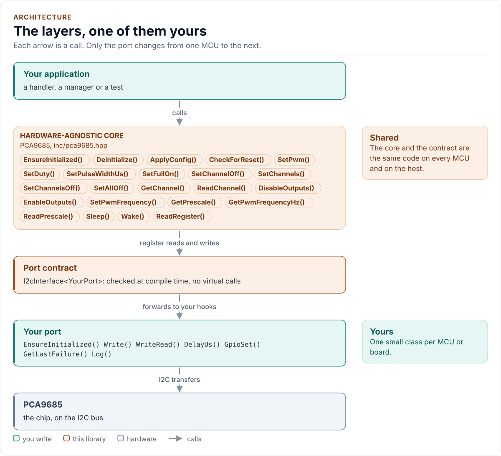
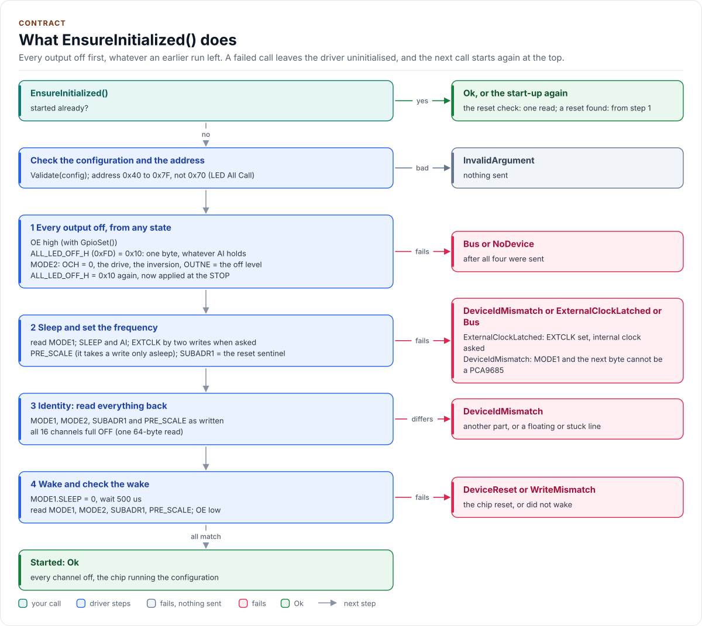
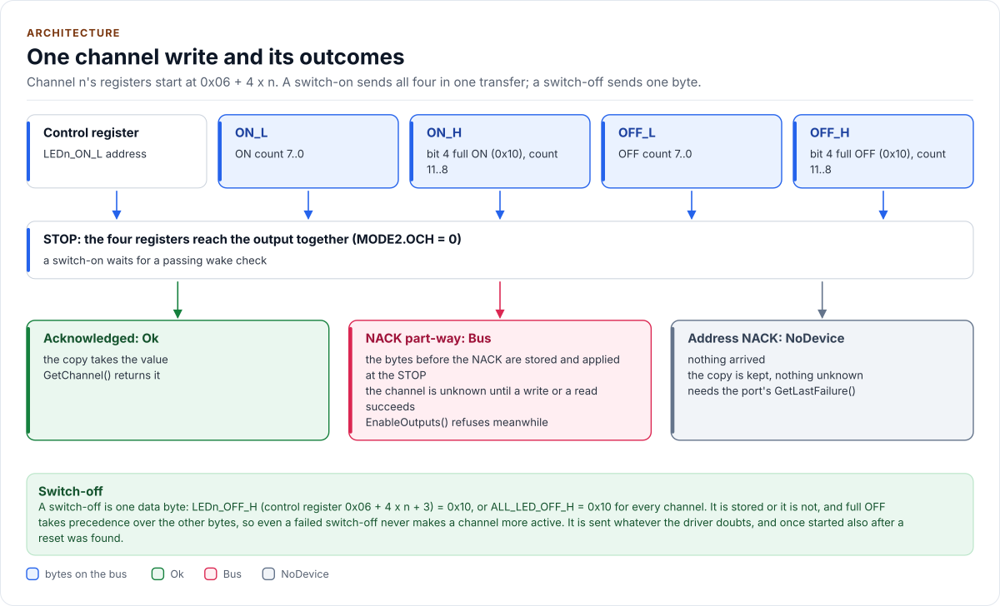
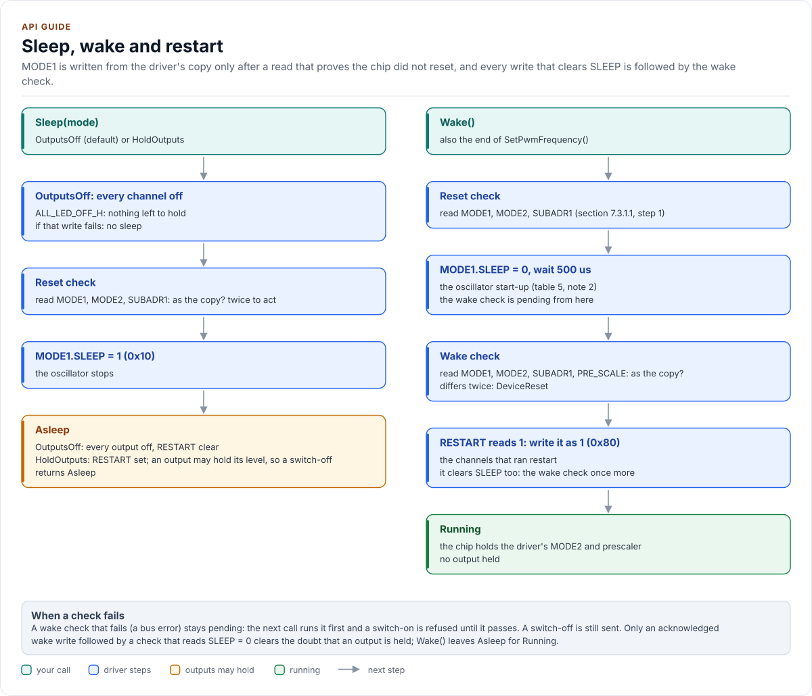
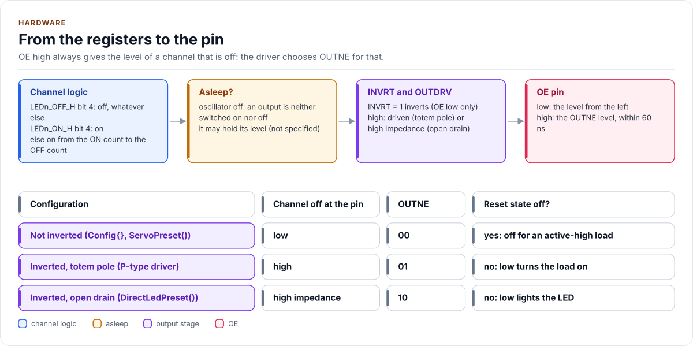

# Architecture

How the driver is built: three layers, one of them yours, and what happens inside the calls that matter most.

<!-- generated: datasheet-refs -->
??? abstract "Datasheet sections this page relies on"

    From NXP PCA9685 Rev. 4:

    - Control register: 7.2 Control register, [p. 9](https://www.nxp.com/docs/en/data-sheet/PCA9685.pdf#page=9)
    - Register summary and auto-increment: Table 4 Register summary, [p. 10](https://www.nxp.com/docs/en/data-sheet/PCA9685.pdf#page=10)
    - LED output and PWM control, full ON and full OFF: 7.3.3 LED output and PWM control; Table 7; Figure 9, [p. 16](https://www.nxp.com/docs/en/data-sheet/PCA9685.pdf#page=16)
    - I2C bus transactions: 9 Bus transactions; Figures 20 to 24, [p. 32](https://www.nxp.com/docs/en/data-sheet/PCA9685.pdf#page=32)

    All of them, with the driver API for each: [Datasheet map](datasheet.md).
<!-- /generated -->

<!-- figure: driver-layers -->
<picture>
  <source media="(prefers-color-scheme: dark)" srcset="diagrams/driver-layers.dark.svg">
  
</picture>
<!-- /figure -->

## Layers

| Layer | Files | Owns |
| --- | --- | --- |
| Core | [`inc/pca9685.hpp`](../inc/pca9685.hpp), [`src/pca9685.ipp`](../src/pca9685.ipp) | Lifecycle, channels, frequency, sleep and restart, reset detection, the copy and its doubts, errors |
| Types and registers | [`inc/pca9685_types.hpp`](../inc/pca9685_types.hpp), [`inc/pca9685_registers.hpp`](../inc/pca9685_registers.hpp) | `Error`, `Result<T>`, `Pwm`, `Config` and presets, the frequency and pulse arithmetic; the register map |
| Port contract | [`inc/pca9685_i2c_interface.hpp`](../inc/pca9685_i2c_interface.hpp) | The bus requirements, the CRTP base, `CtrlPin` and `GpioSignal`, the `I2cPort` concept, the optional hooks, the register framing |
| Platform port | Your class | Bus bring-up and byte transfers, the delay, optionally OE, the failure reason and logging |
| Kconfig layer | [`inc/pca9685_kconfig.hpp`](../inc/pca9685_kconfig.hpp) | Optional: a `Config` from ESP-IDF menuconfig |

## Start-up

<!-- figure: start-up -->
<picture>
  <source media="(prefers-color-scheme: dark)" srcset="diagrams/start-up.dark.svg">
  
</picture>
<!-- /figure -->

## One channel write

<!-- figure: channel-write -->
<picture>
  <source media="(prefers-color-scheme: dark)" srcset="diagrams/channel-write.dark.svg">
  
</picture>
<!-- /figure -->

## Sleep, wake and restart

<!-- figure: sleep-restart -->
<picture>
  <source media="(prefers-color-scheme: dark)" srcset="diagrams/sleep-restart.dark.svg">
  
</picture>
<!-- /figure -->

## The output path

<!-- figure: output-path -->
<picture>
  <source media="(prefers-color-scheme: dark)" srcset="diagrams/output-path.dark.svg">
  
</picture>
<!-- /figure -->

## Design choices

- **Every output off before anything else.** The start-up's first frames switch everything off, in a form that
  works whatever an earlier run left (MODE1.AI set or clear, OCH 0 or 1, asleep or awake), and each is sent even if
  one before it failed.
- **The identity check is a read-back.** The chip has no ID register; MODE1, MODE2, PRE_SCALE and all 16 channels
  must read back what was written, which a floating, stuck or looped line cannot produce.
- **A reset sentinel the driver controls.** MODE1.AI is set by the driver and cleared only by a reset; MODE2,
  EXTCLK and PRE_SCALE are written only at start-up and by `SetPwmFrequency()`. The simplest provable rule: any of
  them back at its reset value while the copy differs is a reset.
- **No wake without a check.** Every MODE1 write that clears SLEEP is followed by a read of MODE1, MODE2 and
  PRE_SCALE; a reset chip asleep cannot switch an output on, so it is harmless until it is woken.
- **A failed write is a possible write.** The copy records which channels may hold old, new or mixed values; a
  switch-on that depends on such a value is refused; a switch-off never is.
- **OCH = 0 only.** All bytes of a transfer reach the outputs at its STOP, so a bank of channels changes together
  and a NACK leaves exactly the bytes before it, applied once.
- **OUTNE chosen by the driver.** OE high always gives the level of a channel that is off.
- **CRTP, not virtual functions.** The port is a template parameter constrained by the `I2cPort` concept, so every
  call is resolved at compile time and a missing hook is a compile error that names it.
- **No I/O in the constructor, one error type, no heap, no exceptions, no RTTI, no `std::function`, no `printf`.**

## Source map

| You want | Read |
| --- | --- |
| The public API | [`inc/pca9685.hpp`](../inc/pca9685.hpp) |
| How a call is implemented | [`src/pca9685.ipp`](../src/pca9685.ipp) |
| Register addresses and bits | [`inc/pca9685_registers.hpp`](../inc/pca9685_registers.hpp) |
| The arithmetic and the configuration | [`inc/pca9685_types.hpp`](../inc/pca9685_types.hpp) |
| The port contract | [`inc/pca9685_i2c_interface.hpp`](../inc/pca9685_i2c_interface.hpp) |

Next: [Contract](contract.md).
