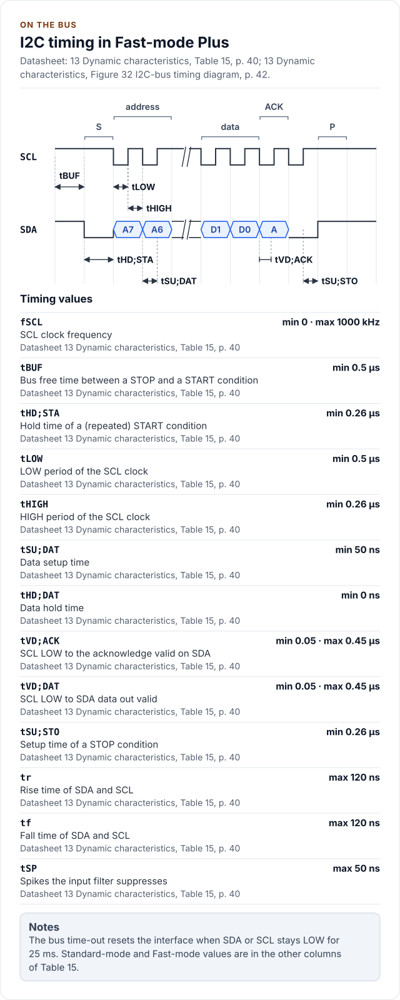
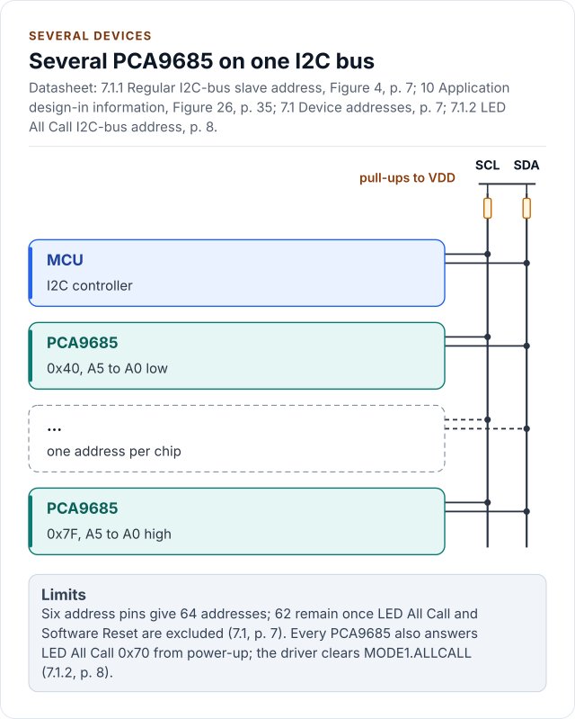

# On the bus

What the PCA9685 needs from the I2C bus, signal by signal, with every time and rate taken from the data sheet. The
connections are on the [Hardware](hardware.md) page and the register transfers in section 9 of the data sheet; this
page is the waveform under them.

## I2C timing

The PCA9685 runs at Standard-mode, Fast-mode and Fast-mode Plus, up to 1 MHz (`kMaxClockHz`). SDA changes while SCL
is LOW and is read while SCL is HIGH; the address byte is `1 A5 A4 A3 A2 A1 A0` and the R/W bit (figure 4). The
figure draws Figure 32 of the data sheet with the Fast-mode Plus values of Table 15.

<!-- figure: i2c-timing -->
<picture>
  <source media="(prefers-color-scheme: dark)" srcset="diagrams/i2c-timing.dark.svg">
  
</picture>
<!-- /figure -->

## Several devices

Six address pins give 64 addresses, `0x40` to `0x7F`; the LED All Call address `0x70` and the Software Reset address
leave 62 for single chips (section 7.1). The pins have no internal pull-ups, so tie each one HIGH or LOW. Every
PCA9685 also answers LED All Call from power-up; the driver clears MODE1.ALLCALL so that each chip answers only its
own address.

<!-- figure: i2c-topology -->
<picture>
  <source media="(prefers-color-scheme: dark)" srcset="diagrams/i2c-topology.dark.svg">
  
</picture>
<!-- /figure -->

## How these figures are made

Each figure is a model in `docs/model/` (`i2c-timing.timing.yml` and `i2c-topology.topology.yml`) that cites the
datasheet section and page of every number; `kokeb-docs figures` draws it and the build fails on a number without a
citation. The values table under the waveform is also written as `docs/diagrams/i2c-timing.table.html`.
