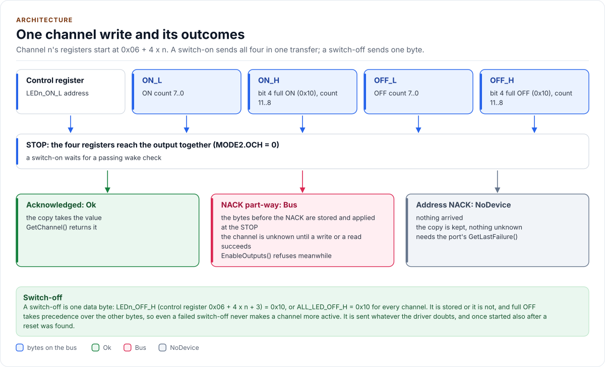
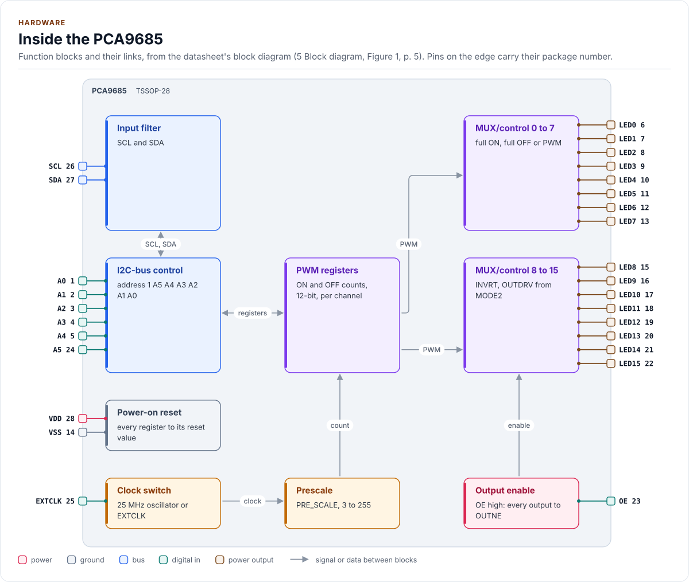
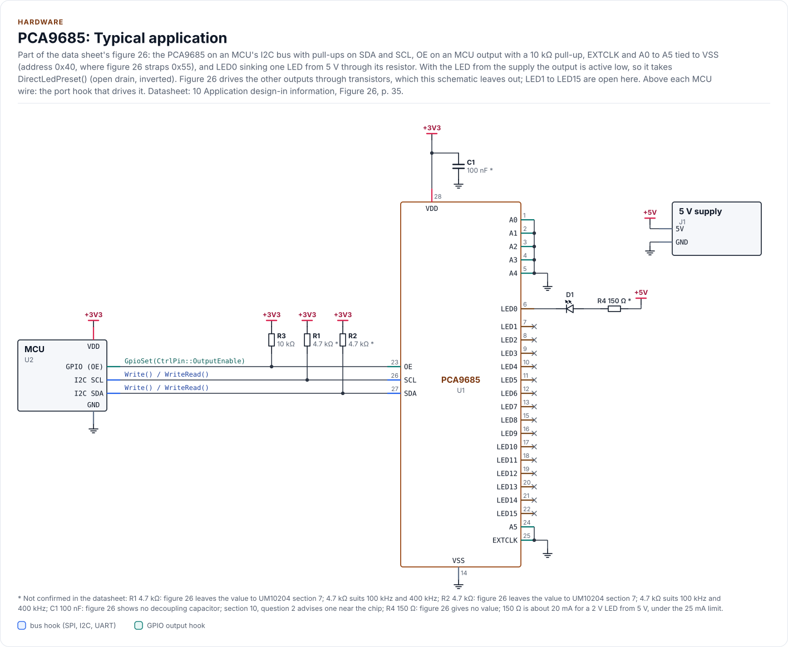
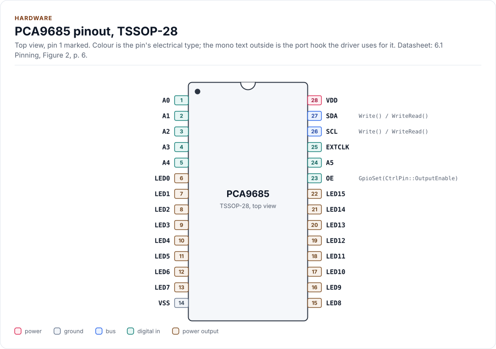
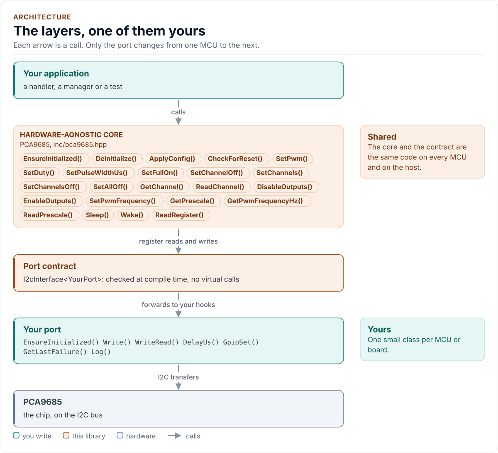
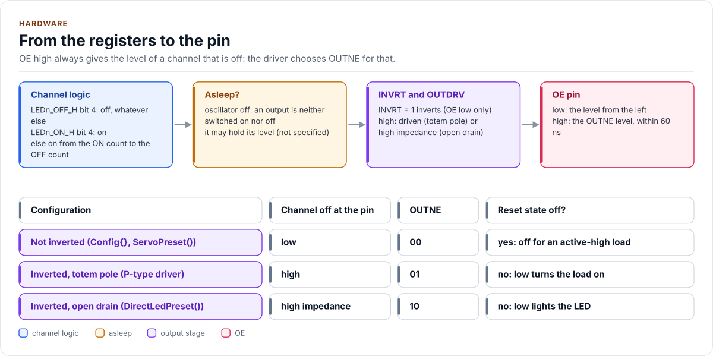
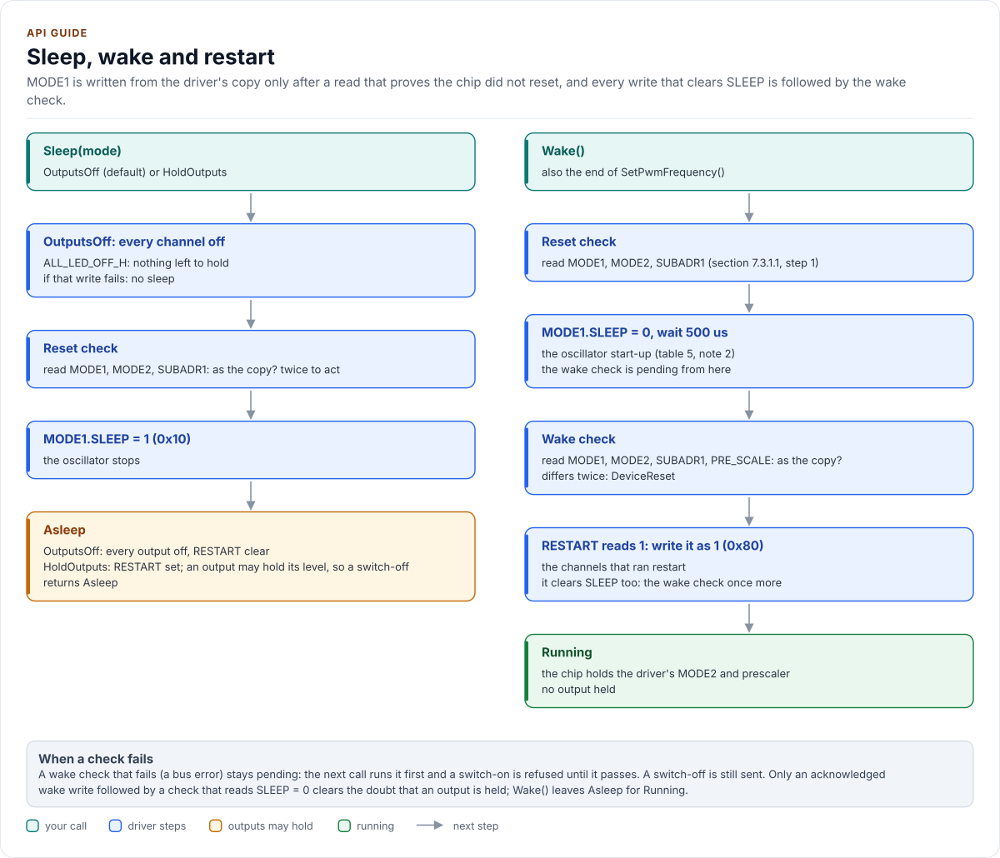
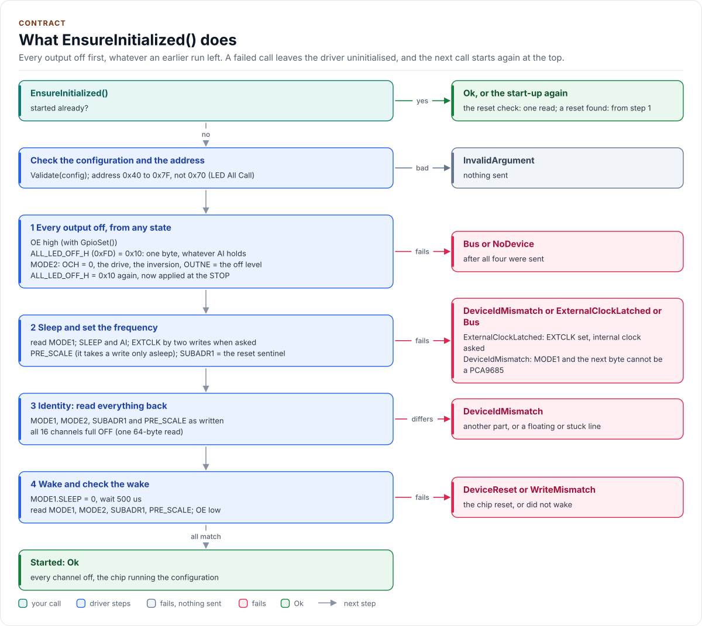

# Figures

<!-- Written by kokeb-docs figures from docs/diagrams/figures/*.py. Do not edit by hand. -->

Every figure on this site is drawn by a Python module from facts extracted from the code, so it is rebuilt,
not redrawn, when the code changes. CI runs `kokeb-docs figures --check` and fails when a
committed figure no longer matches the code. Each figure below lists the files it is drawn from.

## One channel write and its outcomes

<!-- figure: channel-write -->
<picture>
  <source media="(prefers-color-scheme: dark)" srcset="channel-write.dark.svg">
  
</picture>
<!-- /figure -->

Figure module: [`docs/diagrams/figures/channel-write.py`](../../docs/diagrams/figures/channel-write.py)

Drawn from:

- `applyOne, switchOn, switchOff, afterSwitchOff, writeChannels` in [`src/pca9685.ipp`](../../src/pca9685.ipp)
- `kLed0OnL, kBytesPerChannel, kLedFull` in [`inc/pca9685_registers.hpp`](../../inc/pca9685_registers.hpp)

## Inside the PCA9685

<!-- figure: chip-blocks -->
<picture>
  <source media="(prefers-color-scheme: dark)" srcset="chip-blocks.dark.svg">
  
</picture>
<!-- /figure -->

Hardware description: [`docs/hardware.yml`](../hardware.yml)

Drawn from:

- [`docs/hardware.yml`](../hardware.yml)
- [`inc/pca9685_i2c_interface.hpp`](../../inc/pca9685_i2c_interface.hpp)

## PCA9685: Typical application

<!-- figure: chip-circuit-typical -->
<picture>
  <source media="(prefers-color-scheme: dark)" srcset="chip-circuit-typical.dark.svg">
  
</picture>
<!-- /figure -->

Hardware description: [`docs/hardware.yml`](../hardware.yml)

Drawn from:

- [`docs/hardware.yml`](../hardware.yml)
- [`inc/pca9685_i2c_interface.hpp`](../../inc/pca9685_i2c_interface.hpp)

## PCA9685 pinout, TSSOP-28

<!-- figure: chip-pinout -->
<picture>
  <source media="(prefers-color-scheme: dark)" srcset="chip-pinout.dark.svg">
  
</picture>
<!-- /figure -->

Hardware description: [`docs/hardware.yml`](../hardware.yml)

Drawn from:

- [`docs/hardware.yml`](../hardware.yml)
- [`inc/pca9685_i2c_interface.hpp`](../../inc/pca9685_i2c_interface.hpp)

## The layers, one of them yours

<!-- figure: driver-layers -->
<picture>
  <source media="(prefers-color-scheme: dark)" srcset="driver-layers.dark.svg">
  
</picture>
<!-- /figure -->

Figure module: [`docs/diagrams/figures/driver-layers.py`](../../docs/diagrams/figures/driver-layers.py)

Drawn from:

- `public calls` in [`inc/pca9685.hpp`](../../inc/pca9685.hpp)
- `I2cInterface` in [`inc/pca9685_i2c_interface.hpp`](../../inc/pca9685_i2c_interface.hpp)

## From the registers to the pin

<!-- figure: output-path -->
<picture>
  <source media="(prefers-color-scheme: dark)" srcset="output-path.dark.svg">
  
</picture>
<!-- /figure -->

Figure module: [`docs/diagrams/figures/output-path.py`](../../docs/diagrams/figures/output-path.py)

Drawn from:

- `OffLevelOutne, Mode2Value` in [`inc/pca9685.hpp`](../../inc/pca9685.hpp)
- `kOutneLow, kOutneHigh, kOutneHiZ, kLedFull` in [`inc/pca9685_registers.hpp`](../../inc/pca9685_registers.hpp)
- `applyOne` in [`src/pca9685.ipp`](../../src/pca9685.ipp)

## Sleep, wake and restart

<!-- figure: sleep-restart -->
<picture>
  <source media="(prefers-color-scheme: dark)" srcset="sleep-restart.dark.svg">
  
</picture>
<!-- /figure -->

Figure module: [`docs/diagrams/figures/sleep-restart.py`](../../docs/diagrams/figures/sleep-restart.py)

Drawn from:

- `Sleep, Wake, wakeSequence, completeWakeCheck, verifyRunning, SetPwmFrequency, changePrescale` in [`src/pca9685.ipp`](../../src/pca9685.ipp)
- `kMode1Sleep, kMode1Restart` in [`inc/pca9685_registers.hpp`](../../inc/pca9685_registers.hpp)
- `kOscillatorStartUs` in [`inc/pca9685_types.hpp`](../../inc/pca9685_types.hpp)

## What EnsureInitialized() does

<!-- figure: start-up -->
<picture>
  <source media="(prefers-color-scheme: dark)" srcset="start-up.dark.svg">
  
</picture>
<!-- /figure -->

Figure module: [`docs/diagrams/figures/start-up.py`](../../docs/diagrams/figures/start-up.py)

Drawn from:

- `EnsureInitialized, initialize, enterSafeState, configureClock, checkIdentity, wakeSequence, addressValid` in [`src/pca9685.ipp`](../../src/pca9685.ipp)
- `kMinI2cAddress, kMaxI2cAddress, kAllCallAddress, kOscillatorStartUs` in [`inc/pca9685_types.hpp`](../../inc/pca9685_types.hpp)
- `kAllLedOffH, kLedFull` in [`inc/pca9685_registers.hpp`](../../inc/pca9685_registers.hpp)
