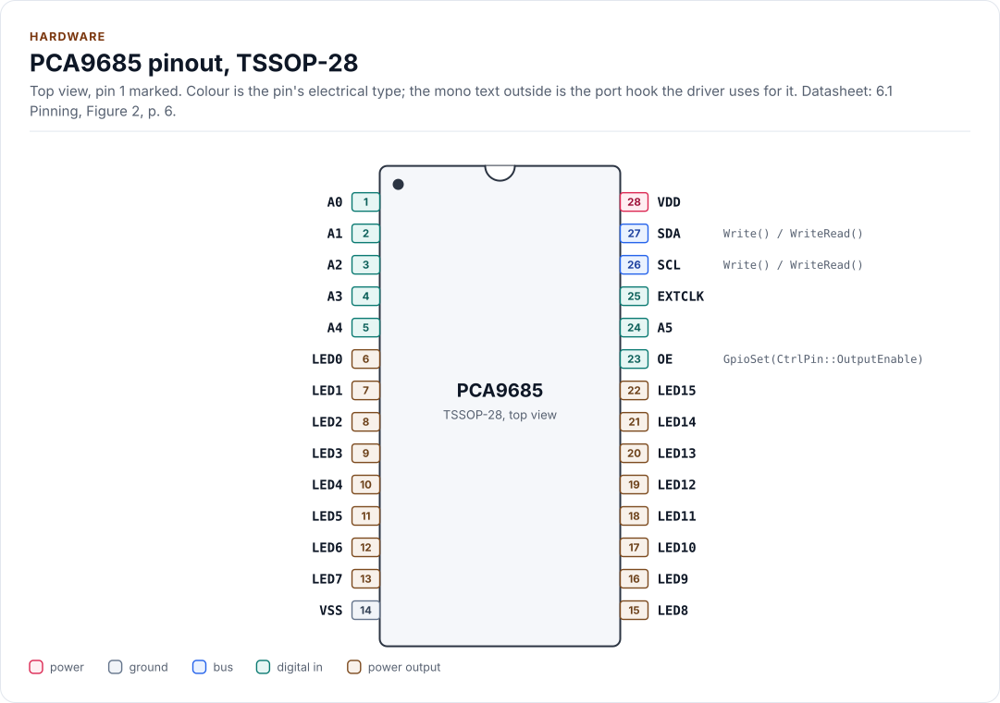
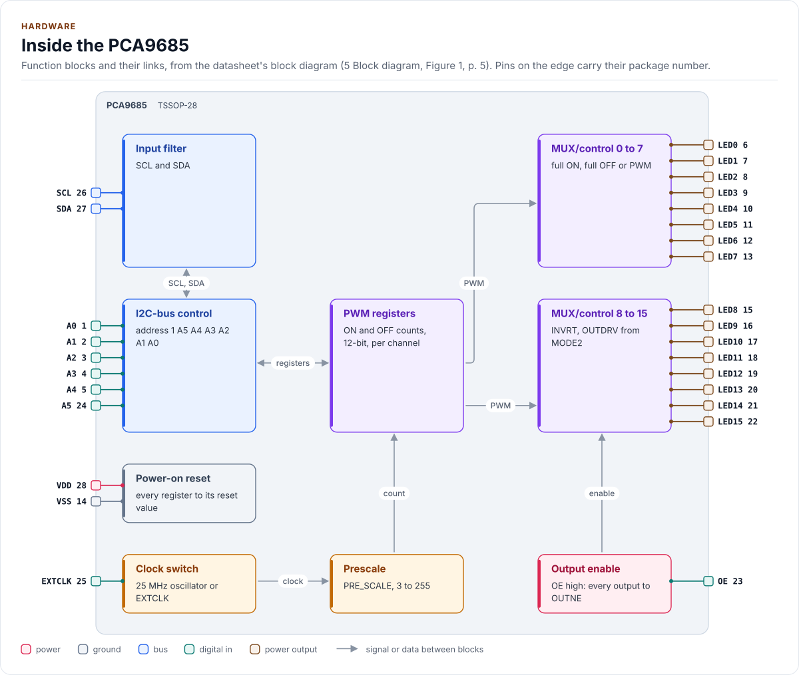
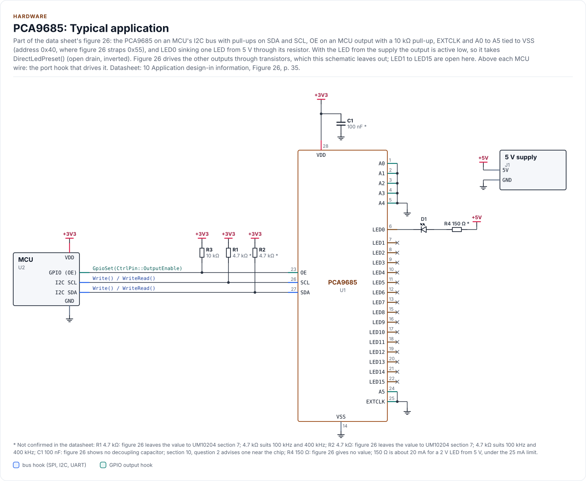

# Hardware

The pins of both packages, the I2C address, OE, EXTCLK, the bus pull-ups, the reference application circuit with
LEDs and servos, and the power. Section and figure numbers are the data sheet's.

<!-- generated: datasheet-refs -->
??? abstract "Datasheet sections this page relies on"

    From NXP PCA9685 Rev. 4:

    - Pins and packages (TSSOP28, HVQFN28): 6 Pinning information; Table 3 Pin description, [p. 6](https://www.nxp.com/docs/en/data-sheet/PCA9685.pdf#page=6)
    - Slave address, A0 to A5: 7.1.1 Regular I2C-bus slave address; Figure 4, [p. 7](https://www.nxp.com/docs/en/data-sheet/PCA9685.pdf#page=7)
    - LED All Call and Sub Call addresses: 7.1.2 LED All Call I2C-bus address; 7.1.3 LED Sub Call I2C-bus addresses, [p. 8](https://www.nxp.com/docs/en/data-sheet/PCA9685.pdf#page=8)
    - Software Reset address: 7.1.4 Software Reset I2C-bus address, [p. 9](https://www.nxp.com/docs/en/data-sheet/PCA9685.pdf#page=9)
    - MODE2, output drive, inversion, change on STOP, OUTNE: 7.3.2 Mode register 2, MODE2; Table 6, [p. 16](https://www.nxp.com/docs/en/data-sheet/PCA9685.pdf#page=16)
    - Output enable, OE: 7.4 Active LOW output enable input; Table 11, [p. 27](https://www.nxp.com/docs/en/data-sheet/PCA9685.pdf#page=27)
    - External drivers, INVRT and OUTDRV: 7.7 Using the PCA9685 with and without external drivers; Table 12; Figures 13 to 15, [p. 29](https://www.nxp.com/docs/en/data-sheet/PCA9685.pdf#page=29)
    - Typical application: 10 Application design-in information; Figure 26, [p. 35](https://www.nxp.com/docs/en/data-sheet/PCA9685.pdf#page=35)
    - Supply, power-on reset voltage and output currents: 11 Limiting values; 12 Static characteristics, [p. 38](https://www.nxp.com/docs/en/data-sheet/PCA9685.pdf#page=38)
    - I2C timing, EXTCLK and OE propagation: 13 Dynamic characteristics; Table 15, [p. 40](https://www.nxp.com/docs/en/data-sheet/PCA9685.pdf#page=40)

    All of them, with the driver API for each: [Datasheet map](datasheet.md).
<!-- /generated -->

## Packages

| Type number | Package | Body | Notes |
| --- | --- | --- | --- |
| PCA9685PW | TSSOP28 (SOT361-1) | 9.7 mm x 4.4 mm, 0.65 mm pitch | |
| PCA9685PW/Q900 | TSSOP28 (SOT361-1) | as above | AEC-Q100 |
| PCA9685BS | HVQFN28 (SOT788-1) | 6 mm x 6 mm x 0.85 mm | Exposed pad is ground: solder it, with thermal vias |

## Pins

TSSOP28 pin numbers (table 3); each pin's function gives its HVQFN28 number, and the HVQFN28 exposed pad is VSS.
Every input is 5.5 V tolerant whatever VDD is.

<!-- figure: chip-pinout -->
<picture>
  <source media="(prefers-color-scheme: dark)" srcset="diagrams/chip-pinout.dark.svg">
  
</picture>
<!-- /figure -->

<!-- generated: chip-pins -->
TSSOP-28, 28 pins (6.1 Pinning, Figure 2, [p. 6](https://www.nxp.com/docs/en/data-sheet/PCA9685.pdf#page=6)).

| Pin | Name | Type (domain) | Function | Driver hook | If unused | Datasheet |
| --- | --- | --- | --- | --- | --- | --- |
| 1 | `A0` | digital in (VDD) | Address input 0, no internal pull-up; tie to VDD or VSS (HVQFN28 pin 26) | - | Never open | 7.1.1, [p. 7](https://www.nxp.com/docs/en/data-sheet/PCA9685.pdf#page=7) |
| 2 | `A1` | digital in (VDD) | Address input 1, no internal pull-up; tie to VDD or VSS (HVQFN28 pin 27) | - | Never open | 7.1.1, [p. 7](https://www.nxp.com/docs/en/data-sheet/PCA9685.pdf#page=7) |
| 3 | `A2` | digital in (VDD) | Address input 2, no internal pull-up; tie to VDD or VSS (HVQFN28 pin 28) | - | Never open | 7.1.1, [p. 7](https://www.nxp.com/docs/en/data-sheet/PCA9685.pdf#page=7) |
| 4 | `A3` | digital in (VDD) | Address input 3, no internal pull-up; tie to VDD or VSS (HVQFN28 pin 1) | - | Never open | 7.1.1, [p. 7](https://www.nxp.com/docs/en/data-sheet/PCA9685.pdf#page=7) |
| 5 | `A4` | digital in (VDD) | Address input 4, no internal pull-up; tie to VDD or VSS (HVQFN28 pin 2) | - | Never open | 7.1.1, [p. 7](https://www.nxp.com/docs/en/data-sheet/PCA9685.pdf#page=7) |
| 6 | `LED0` | power output (VDD) | Output of channel 0 (HVQFN28 pin 3) | - | Leave open | 6.2, [p. 6](https://www.nxp.com/docs/en/data-sheet/PCA9685.pdf#page=6) |
| 7 | `LED1` | power output (VDD) | Output of channel 1 (HVQFN28 pin 4) | - | Leave open | 6.2, [p. 6](https://www.nxp.com/docs/en/data-sheet/PCA9685.pdf#page=6) |
| 8 | `LED2` | power output (VDD) | Output of channel 2 (HVQFN28 pin 5) | - | Leave open | 6.2, [p. 6](https://www.nxp.com/docs/en/data-sheet/PCA9685.pdf#page=6) |
| 9 | `LED3` | power output (VDD) | Output of channel 3 (HVQFN28 pin 6) | - | Leave open | 6.2, [p. 6](https://www.nxp.com/docs/en/data-sheet/PCA9685.pdf#page=6) |
| 10 | `LED4` | power output (VDD) | Output of channel 4 (HVQFN28 pin 7) | - | Leave open | 6.2, [p. 6](https://www.nxp.com/docs/en/data-sheet/PCA9685.pdf#page=6) |
| 11 | `LED5` | power output (VDD) | Output of channel 5 (HVQFN28 pin 8) | - | Leave open | 6.2, [p. 6](https://www.nxp.com/docs/en/data-sheet/PCA9685.pdf#page=6) |
| 12 | `LED6` | power output (VDD) | Output of channel 6 (HVQFN28 pin 9) | - | Leave open | 6.2, [p. 6](https://www.nxp.com/docs/en/data-sheet/PCA9685.pdf#page=6) |
| 13 | `LED7` | power output (VDD) | Output of channel 7 (HVQFN28 pin 10) | - | Leave open | 6.2, [p. 6](https://www.nxp.com/docs/en/data-sheet/PCA9685.pdf#page=6) |
| 14 | `VSS` | ground | Ground; up to 400 mA in all (HVQFN28 pin 11 and the exposed pad) | - | - | 6.2, [p. 6](https://www.nxp.com/docs/en/data-sheet/PCA9685.pdf#page=6) |
| 15 | `LED8` | power output (VDD) | Output of channel 8 (HVQFN28 pin 12) | - | Leave open | 6.2, [p. 6](https://www.nxp.com/docs/en/data-sheet/PCA9685.pdf#page=6) |
| 16 | `LED9` | power output (VDD) | Output of channel 9 (HVQFN28 pin 13) | - | Leave open | 6.2, [p. 6](https://www.nxp.com/docs/en/data-sheet/PCA9685.pdf#page=6) |
| 17 | `LED10` | power output (VDD) | Output of channel 10 (HVQFN28 pin 14) | - | Leave open | 6.2, [p. 6](https://www.nxp.com/docs/en/data-sheet/PCA9685.pdf#page=6) |
| 18 | `LED11` | power output (VDD) | Output of channel 11 (HVQFN28 pin 15) | - | Leave open | 6.2, [p. 6](https://www.nxp.com/docs/en/data-sheet/PCA9685.pdf#page=6) |
| 19 | `LED12` | power output (VDD) | Output of channel 12 (HVQFN28 pin 16) | - | Leave open | 6.2, [p. 7](https://www.nxp.com/docs/en/data-sheet/PCA9685.pdf#page=7) |
| 20 | `LED13` | power output (VDD) | Output of channel 13 (HVQFN28 pin 17) | - | Leave open | 6.2, [p. 7](https://www.nxp.com/docs/en/data-sheet/PCA9685.pdf#page=7) |
| 21 | `LED14` | power output (VDD) | Output of channel 14 (HVQFN28 pin 18) | - | Leave open | 6.2, [p. 7](https://www.nxp.com/docs/en/data-sheet/PCA9685.pdf#page=7) |
| 22 | `LED15` | power output (VDD) | Output of channel 15 (HVQFN28 pin 19) | - | Leave open | 6.2, [p. 7](https://www.nxp.com/docs/en/data-sheet/PCA9685.pdf#page=7) |
| 23 | `OE` | digital in (VDD) | Output enable, active low; high sets every output to the OUTNE level (HVQFN28 pin 20) | `GpioSet(CtrlPin::OutputEnable)` | Tie to VSS | 7.4, [p. 27](https://www.nxp.com/docs/en/data-sheet/PCA9685.pdf#page=27) |
| 24 | `A5` | digital in (VDD) | Address input 5, no internal pull-up; tie to VDD or VSS (HVQFN28 pin 21) | - | Never open | 7.1.1, [p. 7](https://www.nxp.com/docs/en/data-sheet/PCA9685.pdf#page=7) |
| 25 | `EXTCLK` | digital in (VDD) | External clock input, DC to 50 MHz (HVQFN28 pin 22) | - | Tie to VSS | 6.2, [p. 7](https://www.nxp.com/docs/en/data-sheet/PCA9685.pdf#page=7) |
| 26 | `SCL` | bus (VDD) | I2C clock, up to 1 MHz; pull-up to the bus supply (HVQFN28 pin 23) | `Write() / WriteRead()` | - | 13, [p. 40](https://www.nxp.com/docs/en/data-sheet/PCA9685.pdf#page=40) |
| 27 | `SDA` | bus (VDD) | I2C data; pull-up to the bus supply (HVQFN28 pin 24) | `Write() / WriteRead()` | - | 6.2, [p. 7](https://www.nxp.com/docs/en/data-sheet/PCA9685.pdf#page=7) |
| 28 | `VDD` | power (VDD) | Supply, 2.3 V to 5.5 V (HVQFN28 pin 25) | - | - | 12, [p. 38](https://www.nxp.com/docs/en/data-sheet/PCA9685.pdf#page=38) |

Source of this table and of the chip figures: [`docs/hardware.yml`](hardware.yml).
<!-- /generated -->

LED*n* is channel *n* of the driver: `SetDuty(n, ...)`.

## Blocks

Figure 1 of the data sheet, which draws one output for clarity; here the 16 outputs are split over two blocks.

<!-- figure: chip-blocks -->
<picture>
  <source media="(prefers-color-scheme: dark)" srcset="diagrams/chip-blocks.dark.svg">
  
</picture>
<!-- /figure -->

## Address

The 7-bit address is `1 A5 A4 A3 A2 A1 A0` (figure 4): `0x40` (`kI2cAddress`) with every pin low, up to `0x7F`.
The address pins have no internal pull-ups (section 7.1.1): tie each one to VDD or VSS, never leave one open.

| A5 A4 A3 A2 A1 A0 | Address |
| --- | --- |
| 000000 | `0x40` |
| 000001 | `0x41` |
| 110000 | `0x70`: not usable, see below |
| 111111 | `0x7F` |

Every PCA9685 also acknowledges the LED All Call address, `0x70`, from power-up until MODE1.ALLCALL is cleared
(section 7.1.2). A chip strapped to `0x70` would share it with every other PCA9685 on the bus, so the driver
refuses that address (`InvalidArgument`, no I/O). `EnsureInitialized()` clears ALLCALL and the three Sub Call
enables, so once started the chip answers only its own address. The general call address `0x00` with the byte
`0x06` resets every PCA9685 on the bus (section 7.6); the driver never sends it, and finds the reset it causes.

## Output enable (OE)

OE low lets the outputs follow their channels; OE high sets every output to the MODE2.OUTNE level within 60 ns
(section 7.4, table 15). The driver chooses OUTNE so that OE high always gives the level of a channel that is off:

| `Config` | Channel off at the pin | OUTNE | OE high at the pin |
| --- | --- | --- | --- |
| not inverted (`invert_outputs = false`) | low | 00 | low |
| inverted, totem pole | high | 01 | high |
| inverted, open drain | high impedance | 10 | high impedance |

So `DisableOutputs()` (OE high) is the fast switch-off: a pin write, no bus traffic, and it works asleep or with
the bus down. Wire OE to a GPIO with a pull-up to VDD (10 kΩ): the outputs stay disabled until the MCU drives OE
low, through MCU reset and boot. The data sheet's figure 26 shows the pull-up as needed when the MCU's OE drive is
open drain. Without the GPIO, tie OE to VSS and leave out the port's `GpioSet()`.

OE can also dim or blink every output together with an external PWM on it (section 7.4); the driver does not use
that, but it does not stop it either.

## EXTCLK

The PWM counter runs from the internal oscillator, 25 MHz typical, or from EXTCLK, DC to 50 MHz (table 15). EXTCLK
must be grounded when it is not used (table 3, note 2). Select it with `Config::clock = ClockSource::External` and
`Config::oscillator_hz` set to its frequency; the start-up sets MODE1.EXTCLK by the two-write sequence of table 5.
EXTCLK then stays set until a power cycle or a software reset: a later start with the internal clock returns
`ExternalClockLatched`. An external clock needs no start-up wait, and it lets several PCA9685 run in step.

The internal oscillator is specified only as 25 MHz typical, so the PWM period and every pulse width are only as
accurate as it is. For servo work, measure the period on one output once and set `Config::oscillator_hz` to
`4096 x (PRE_SCALE + 1) / period` (**not verified on hardware**: bench step 4 in [Testing and CI](testing.md#on-hardware)).

## I2C bus

| Setting | Value | Source |
| --- | --- | --- |
| Address | `0x40` to `0x7F`, not `0x70` | figure 4, section 7.1.2 |
| SCL | Standard (100 kHz), Fast (400 kHz) or Fast-mode Plus (1 MHz) | table 15 |
| Reads | Control register write, repeated START, read (`kRepeatedStart`) | figure 22 |
| Bus time-out | The chip resets its bus interface when SDA or SCL is held low for 25 ms or more | table 15, note 1 |

SDA and SCL need pull-ups to the bus supply (section 8): choose them for the bus capacitance and speed by the I2C
specification, UM10204 section 7 (figure 26, note 1). As a start, 4.7 kΩ suits 100 kHz and 400 kHz on a short
bus; Fast-mode Plus needs stronger pull-ups, which the SDA output's 30 mA sink allows (section 2).

## Reference application circuit

Figure 26 of the data sheet: an I2C master with SDA and SCL pull-ups, OE on a GPIO with a 10 kΩ pull-up, EXTCLK
and A0 to A5 strapped, and the 16 outputs driving LED strings from 5 V or 12 V through external transistors. Its
remark sets INVRT = 0, OUTDRV = 1, OUTNE = 01 for that circuit; the driver's `Config{}` matches it except OUTNE,
which the driver makes 00 so that OE high switches the strings off rather than on.

The schematic below is the part of figure 26 that has no transistors, with one LED on LED0; parts the figure gives
no value for are marked as not confirmed.

<!-- figure: chip-circuit-typical -->
<picture>
  <source media="(prefers-color-scheme: dark)" srcset="diagrams/chip-circuit-typical.dark.svg">
  
</picture>
<!-- /figure -->

<!-- generated: chip-parts -->
| Part | Kind | Value | Connects | Datasheet |
| --- | --- | --- | --- | --- |
| U2 | MCU | - | VDD: +3V3, GND: GND, SCL: SCL, SDA: SDA, OE: OE | 10, [p. 35](https://www.nxp.com/docs/en/data-sheet/PCA9685.pdf#page=35) |
| R1 | resistor | 4.7 kΩ (not confirmed: figure 26 leaves the value to UM10204 section 7; 4.7 kΩ suits 100 kHz and 400 kHz) | +3V3, SCL | 10, [p. 35](https://www.nxp.com/docs/en/data-sheet/PCA9685.pdf#page=35) |
| R2 | resistor | 4.7 kΩ (not confirmed: figure 26 leaves the value to UM10204 section 7; 4.7 kΩ suits 100 kHz and 400 kHz) | +3V3, SDA | 10, [p. 35](https://www.nxp.com/docs/en/data-sheet/PCA9685.pdf#page=35) |
| R3 | resistor | 10 kΩ | +3V3, OE | 10, [p. 35](https://www.nxp.com/docs/en/data-sheet/PCA9685.pdf#page=35) |
| C1 | capacitor | 100 nF (not confirmed: figure 26 shows no decoupling capacitor; section 10, question 2 advises one near the chip) | +3V3, GND | 10, [p. 35](https://www.nxp.com/docs/en/data-sheet/PCA9685.pdf#page=35) |
| R4 | resistor | 150 Ω (not confirmed: figure 26 gives no value; 150 Ω is about 20 mA for a 2 V LED from 5 V, under the 25 mA limit) | +5V, LED_A | 10, [p. 35](https://www.nxp.com/docs/en/data-sheet/PCA9685.pdf#page=35) |
| D1 | led | - | LED_A, LED0 | 10, [p. 35](https://www.nxp.com/docs/en/data-sheet/PCA9685.pdf#page=35) |
| J1 | 5 V supply | - | 5V: +5V, GND: GND | 10, [p. 35](https://www.nxp.com/docs/en/data-sheet/PCA9685.pdf#page=35) |

Export a circuit for a schematic or PCB tool: `kokeb-docs hardware --kicad-netlist OUT.net --circuit typical`.
<!-- /generated -->

The three ways to load an output (section 7.7, table 12, figures 13 to 15):

| Load | Wiring | `Config` | Off at reset |
| --- | --- | --- | --- |
| LED direct from the output | LEDn to anode, cathode through a resistor to VSS (up to 25 mA sink, 10 mA source per output) | `Config{}` (totem pole, not inverted) | yes |
| LED from the supply | VDD (5.5 V at most) through a resistor and the LED into LEDn | `DirectLedPreset()` (open drain, inverted) | **no** |
| External N-type transistor (NPN, NMOS) | LEDn to the gate or base; the load from its supply to the drain | `Config{}` | yes |
| External P-type transistor (PNP, PMOS) | LEDn to the gate or base | `Config{.invert_outputs = true}` | **no** |
| Hobby servo | LEDn to the servo's signal input; the servo from its own 5 V to 6 V supply, grounds joined | `ServoPreset()` (50 Hz, totem pole) | yes, no pulses |

**Off at reset** matters: a power-on or software reset puts every output low, not inverted, with OUTNE = 00 (tables
6, 7). For a load wired active high that is off; for one wired active low (an LED from the supply, a P-type
transistor) it is **on**, and neither OE nor the driver can prevent it until `EnsureInitialized()` writes INVRT
again. Prefer active-high wiring where a load must not switch on by itself. LEDs with integrated Zener diodes need
open drain (section 7.3.2, note 1; section 10, question 5): with totem pole the IC overheats.

Servos: 50 Hz is a 20 ms period; 1.0 ms to 2.0 ms pulses are about 205 to 410 counts of 4.88 µs (PRE_SCALE 121
at 25 MHz). `SetPulseWidthUs()` converts with the programmed PRE_SCALE and `Config::oscillator_hz`. Power servos
from their own supply, not from the PCA9685's VDD: a stall current that pulls VDD below V_POR resets the chip.

## Power

| Parameter | Value | Source |
| --- | --- | --- |
| VDD | 2.3 V to 5.5 V (absolute maximum 6.0 V) | tables 13, 14 |
| Supply current | 6 mA typical, 10 mA maximum, operating, no load, 1 MHz SCL | table 14 |
| Standby current | 2.2 µA typical, 15.5 µA maximum, asleep, SCL idle | table 14 |
| Power-on reset | Released at V_POR, 1.70 V typical, 2.0 V maximum; VDD must fall below 0.2 V to reset again | section 7.5, table 14 |
| Output current | 25 mA per output; 400 mA in all through VSS | tables 13, 14 |
| Total power | 400 mW | table 13 |

Decouple VDD with 100 nF at the pin; with many outputs switching at full current, add bulk capacitance near the
chip (section 10, questions 2 and 3). A supply dip below V_POR resets the chip: every channel off and asleep, which
the driver finds ([Contract](contract.md#resets)).

## Reference documents

<!-- generated: datasheet-card -->
| Document | Revision | Get it |
| --- | --- | --- |
| Datasheet: PCA9685 16-channel, 12-bit PWM Fm+ I2C-bus LED controller (NXP PCA9685) | Rev. 4, 2015-04-16 | [PDF](https://www.nxp.com/docs/en/data-sheet/PCA9685.pdf) · [vendor page](https://www.nxp.com/products/PCA9685) |

Written against these revisions; the SHA-256 of each file is in [`docs/datasheets.yml`](datasheets.yml). Where each part
of the driver is in the datasheet: [Datasheet map](datasheet.md).
<!-- /generated -->
