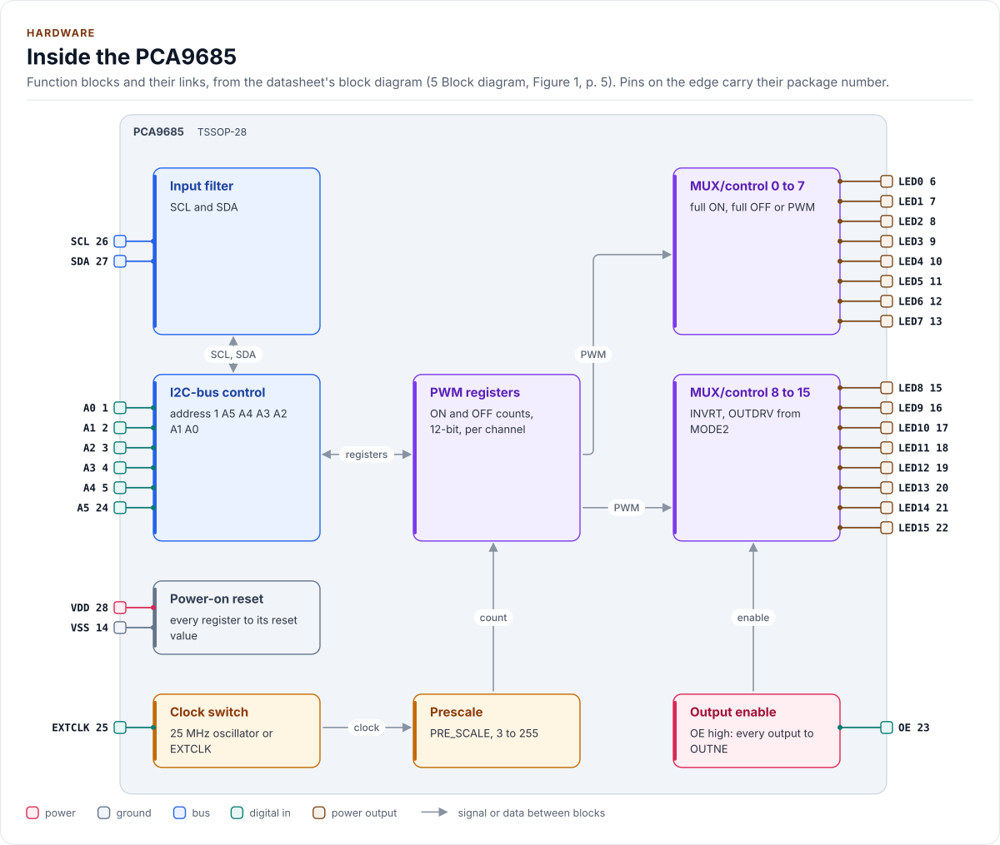
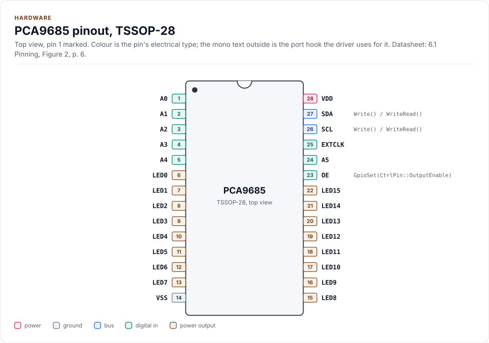
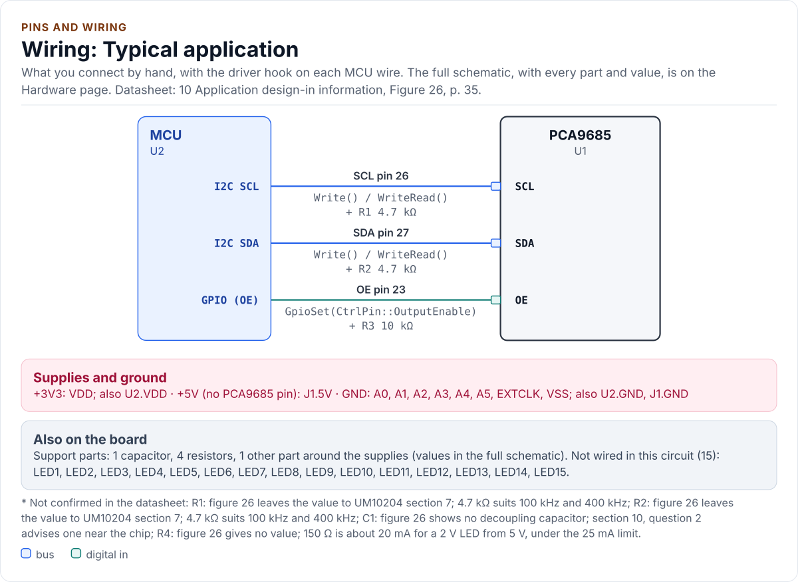

---
hide:
  - navigation
  - toc
---

<div class="kb-hero" markdown>
<span class="kb-kicker">Driver</span>

# PCA9685 Driver

<p>A C++20 driver for the NXP PCA9685 16-channel, 12-bit PWM controller. It starts the chip from any state
with every output off, sets duty, phase and servo pulse widths, changes the frequency by the data sheet's sleep and
restart sequence, finds chip resets and never refuses a switch-off, on any MCU.</p>

[Quickstart](quickstart.md){ .md-button .md-button--primary }
[API guide](api-guide.md){ .md-button }
[Source on GitHub](https://github.com/kokeb-labs-drivers/driver-pca9685){ .md-button }
</div>

<!-- generated: chip-summary -->
The **PCA9685** is a 16-channel LED controller on I2C: each output has its own 12-bit PWM, all at one frequency from
about 24 Hz to 1526 Hz, and drives an LED directly or the input of an external driver (1 General description, [p.
1](https://www.nxp.com/docs/en/data-sheet/PCA9685.pdf#page=1)).
<!-- /generated -->

<!-- figure: chip-hero -->
<picture>
  <source media="(prefers-color-scheme: dark)" srcset="diagrams/chip-hero.dark.svg">
  
</picture>
<!-- /figure -->

## What it does

<!-- figure: chip-capabilities -->
<picture>
  <source media="(prefers-color-scheme: dark)" srcset="diagrams/chip-capabilities.dark.svg">
  
</picture>
<!-- /figure -->

## Where it is used

<!-- generated: chip-uses -->
- RGB or RGBA LED drivers
- LED status information
- LED displays
- LCD backlights
- Keypad backlights of handheld devices

Uses named by the datasheet (3 Applications, [p. 3](https://www.nxp.com/docs/en/data-sheet/PCA9685.pdf#page=3)).
<!-- /generated -->

## Inside the chip

<!-- figure: chip-blocks -->
<picture>
  <source media="(prefers-color-scheme: dark)" srcset="diagrams/chip-blocks.dark.svg">
  
</picture>
<!-- /figure -->

## Pins and wiring

<!-- figure: chip-pinout -->
<picture>
  <source media="(prefers-color-scheme: dark)" srcset="diagrams/chip-pinout.dark.svg">
  
</picture>
<!-- /figure -->

<!-- figure: chip-wiring-typical -->
<picture>
  <source media="(prefers-color-scheme: dark)" srcset="diagrams/chip-wiring-typical.dark.svg">
  
</picture>
<!-- /figure -->

<div class="kb-chip" markdown>
<div class="kb-chip__head">
<span class="kb-chip__kicker">PWM controller</span>
<span class="kb-chip__name">PCA9685</span>
<span class="kb-chip__vendor">NXP</span>
</div>

Function
:   16 outputs, each with its own 12-bit PWM (4096 steps) and turn-on delay, all at one frequency

Frequency
:   About 24 Hz to 1526 Hz from the 25 MHz internal oscillator (PRE_SCALE 3 to 255), or from EXTCLK up to 50 MHz

Interface
:   I2C up to 1 MHz (Fm+); 7-bit address `0x40` to `0x7F` from A0 to A5; register auto-increment

Outputs
:   Totem pole (25 mA sink, 10 mA source at 5 V) or open drain; invertible; OE pin sets all to a chosen level

Supply
:   2.3 V to 5.5 V; 5.5 V tolerant inputs and outputs
</div>

Every pin, the reference circuits, the bus settings, the timing and the power: [Hardware](hardware.md).

## Quick start

Wire the chip as above, write the port for your MCU ([Porting](porting.md)), then:

<!-- generated: quickstart-code -->
```cpp
#include "pca9685.hpp"

int dim_led_to_quarter(MyPort& port) {
  pca9685::PCA9685<MyPort> pwm(port); // address 0x40 (A5..A0 low), Config{}: no I/O yet

  if (auto r = pwm.EnsureInitialized(); !r) { // 1. every channel off, configured, oscillator on
    return static_cast<int>(r.error); //    Bus or DeviceIdMismatch: check wiring and address
  }
  if (auto r = pwm.SetDuty(0, 1024); !r) { // 2. LED0 on for 1024 of 4096 counts, 200 Hz
    return static_cast<int>(r.error);
  }
  return static_cast<int>(pwm.SetChannelOff(0).error); // 3. off again: never refused
}
```
<!-- /generated -->

Step by step, from a bare chip to the first result: [Quickstart](quickstart.md).

## Driver coverage

<!-- generated: chip-coverage -->
| Capability | What the chip does | Driver API | Registers | Status | Datasheet |
| --- | --- | --- | --- | --- | --- |
| [PWM per channel](api-guide.md) | Sets each output's duty and turn-on delay in 4096 steps, or a servo pulse width in microseconds | `SetPwm`, `SetDuty`, `SetPulseWidthUs`, `ReadChannel` | `LED0_ON_L`, `LED15_OFF_H` | Supported | 7.3.3, [p. 16](https://www.nxp.com/docs/en/data-sheet/PCA9685.pdf#page=16) |
| [Full on and full off](api-guide.md) | Holds an output fully on or fully off with no PWM; a switch-off is never refused | `SetFullOn`, `SetChannelOff`, `SetChannelsOff` | `LED0_ON_L`, `LED15_OFF_H` | Supported | 7.3.3, [p. 16](https://www.nxp.com/docs/en/data-sheet/PCA9685.pdf#page=16) |
| [All channels at once](api-guide.md) | Switches every output off with one write, or changes a run of channels together in one transfer | `SetAllOff`, `SetChannels` | `ALL_LED_OFF_H`, `LED0_ON_L`, `LED15_OFF_H` | Supported | 7.3.4, [p. 25](https://www.nxp.com/docs/en/data-sheet/PCA9685.pdf#page=25) |
| [PWM frequency and clock](configuration.md) | One frequency for all outputs, from the 25 MHz oscillator or an external clock up to 50 MHz | `SetPwmFrequency`, `GetPwmFrequencyHz`, `ReadPrescale`, `ClockSource` | `PRE_SCALE`, `MODE1` | Supported | 7.3.5, [p. 25](https://www.nxp.com/docs/en/data-sheet/PCA9685.pdf#page=25) |
| [Output drive and inversion](configuration.md) | Totem pole or open-drain outputs, optionally inverted, for direct LEDs or external drivers | `OutputDrive`, `DirectLedPreset`, `ApplyConfig` | `MODE2` | Supported | 7.3.2, [p. 16](https://www.nxp.com/docs/en/data-sheet/PCA9685.pdf#page=16) |
| [Output enable pin](hardware.md) | Switches every output to its off level at once through the OE pin, with no bus traffic | `DisableOutputs`, `EnableOutputs` | `MODE2` | Supported | 7.4, [p. 27](https://www.nxp.com/docs/en/data-sheet/PCA9685.pdf#page=27) |
| [Sleep and restart](api-guide.md) | Stops the oscillator to save power, then restarts the PWM where it stopped | `Sleep`, `Wake`, `MayBeAsleep` | `MODE1` | Supported | 7.3.1.1, [p. 15](https://www.nxp.com/docs/en/data-sheet/PCA9685.pdf#page=15) |
| [Reset detection](contract.md) | Starts from any state with every output off, and finds a power-on or software reset | `EnsureInitialized`, `CheckForReset` | `MODE1`, `MODE2`, `SUBADR1` | Supported | 7.5, [p. 27](https://www.nxp.com/docs/en/data-sheet/PCA9685.pdf#page=27) |
| [Group addresses](hardware.md) | LED All Call and three Sub Call addresses; the driver disables them so the chip answers its own only | - | `ALLCALLADR`, `SUBADR1`, `SUBADR2`, `SUBADR3` | Not covered | 7.1.2, [p. 8](https://www.nxp.com/docs/en/data-sheet/PCA9685.pdf#page=8) |

**Supported**: the driver covers it and a host test checks it; **Not covered**: the chip has it and the driver leaves it
alone.

From [`docs/hardware.yml`](hardware.yml); `kokeb-docs hardware --check` confirms that every API name is in
`inc/pca9685.hpp`, `inc/pca9685_types.hpp` and every register in `inc/pca9685_registers.hpp`.
<!-- /generated -->

The driver has no platform code. You give it a small class that brings the bus up and moves bytes; it does the
rest: the start-up from any state, the register framing with auto-increment, the frequency arithmetic, the
sleep and restart sequence, reset detection and the bookkeeping of writes that may or may not have arrived.

### What you get

- **One object per chip.** `PCA9685<YourPort>` takes a reference to your port and does no I/O until
  `EnsureInitialized()`. See [API guide](api-guide.md).
- **Switch-offs you can rely on.** A switch-off is always sent, whatever the driver doubts, and `Ok` means the
  output is off; `DisableOutputs()` uses the OE pin, no bus needed. See [Contract](contract.md).
- **Resets found.** A power-on or software reset is found by its MODE1 sentinel, and the driver never writes its
  cached state over a reset chip. See [Contract](contract.md#resets).
- **Errors you can act on.** Every call returns `Result<T>` with an `Error` such as `Bus`, `DeviceReset` or
  `StateUnknown`. See [API guide](api-guide.md#handle-errors).
- **Datasheet defaults.** `Config{}` holds the chip's reset values, with units in the field names, plus two
  presets for LEDs and servos. See [Configuration](configuration.md).
- **Zero-overhead portability.** The port is a CRTP class checked by a concept: the bus hooks and a delay, plus
  optional OE, failure and logging hooks found at compile time. See [Porting](porting.md).
- **No heap, no exceptions, no RTTI.** The host tests build with `-fno-exceptions -fno-rtti`.
- **Tested without hardware.** Host tests and a fuzzer run the driver against a register model of the chip that
  resets and sleeps on its own. See [Testing and CI](testing.md).

## Datasheet

<!-- generated: datasheet-card -->
| Document | Revision | Get it |
| --- | --- | --- |
| Datasheet: PCA9685 16-channel, 12-bit PWM Fm+ I2C-bus LED controller (NXP PCA9685) | Rev. 4, 2015-04-16 | [PDF](https://www.nxp.com/docs/en/data-sheet/PCA9685.pdf) · [vendor page](https://www.nxp.com/products/power-drivers/lighting-driver-and-controller-ics/led-drivers/16-channel-12-bit-pwm-fm-plus-ic-bus-led-driver:PCA9685) |

Written against these revisions; the SHA-256 of each file is in [`docs/datasheets.yml`](datasheets.yml). Where each part
of the driver is in the datasheet: [Datasheet map](datasheet.md).
<!-- /generated -->

## Where to go next

<div class="grid cards" markdown>

-   :material-rocket-launch-outline: **[Quickstart](quickstart.md)**

    ---

    Wire the chip, write the port, dim an LED in about 15 lines.

-   :material-chip: **[Hardware](hardware.md)**

    ---

    Pins, address, OE, EXTCLK, pull-ups, LEDs and servos, power.

-   :material-file-document-check-outline: **[Contract](contract.md)**

    ---

    What the driver promises, what it needs, threading and errors.

-   :material-code-braces: **[API guide](api-guide.md)**

    ---

    Start, set channels, change the frequency, sleep, handle resets and errors.

-   :material-swap-horizontal: **[Porting](porting.md)**

    ---

    Implement the port for your MCU.

-   :material-book-open-variant: **[API reference](api-reference.md)**

    ---

    Every class and member, generated from the headers.

</div>
